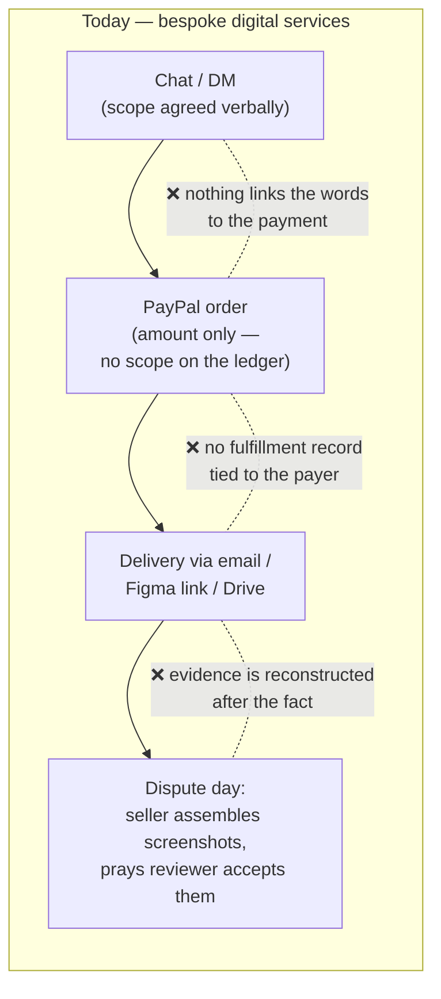
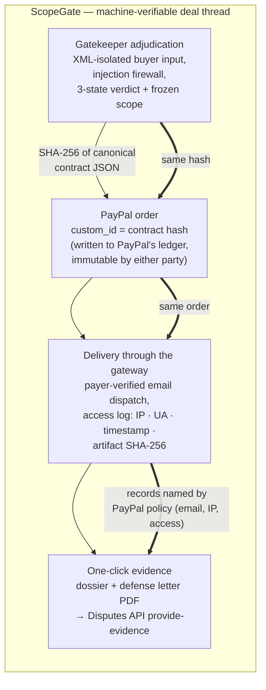

# Old World vs. ScopeGate: Where the Architecture Actually Changes

> Advisor-directed framing (2026-10-23): show the delta, not the whole system.
> Read this side-by-side with `docs/painpoint-verification.md` — every annotated
> difference below is tied to a verified pain point.

## The old world: four disconnected artifacts

The scope, the payment, the delivery, and the evidence live in four different systems
owned by four different parties. At dispute time, only the **payment** is provable —
and it proves the price, not the deal.

## The ScopeGate world: one hash, four anchors

## The delta table (what is actually new, per pain point)

| Pain point (verified in `painpoint-verification.md`) | Old-world failure | ScopeGate mechanism | Innovation type |
|---|---|---|---|
| Scope creep & prompt injection *(the 80% problem)* | Verbal scope, invisible until it's too late; agents can inject instructions into the deal text | **Pre-payment adjudication**: deterministic baseline comparison + LLM classification behind an XML firewall; price moves one way only (ratchet); verdict is ACCEPT / COUNTER / REJECT **before money moves** | Core product innovation — the admission gate itself |
| Dispute black hole *(the 20% problem)* | Evidence assembled by hand after the chargeback; wrong evidence categories; "as agreed" unprovable | **Contract hash anchoring**: the negotiated scope is hashed and written into `purchase_units[0].custom_id` on PayPal's own ledger at order creation; delivery events log exactly the evidence categories PayPal's Intangible Goods Additional Requirements name (recipient email, IP, access); one-click `provide-evidence` submission | The load-bearing crypto primitive — this is the single novel step in the chain |
| Escrow deadlock *(deliberately 0% — borrowed, not built)* | Mutual distrust; self-built escrow = money-transmitter licensing death | **Borrowed rails**: PayPal authorize-then-capture sequencing + the hash-anchored objective contract as the arbitration artifact. We build no custody, no ledger of our own | Not an innovation claim — an explicit scope decision (judges reward knowing what NOT to build) |

## The one-sentence innovation claim

> ScopeGate's innovation is not any single component but the **machine-verifiable thread**:
> one SHA-256 contract hash that is born in the AI adjudication, anchored in PayPal's
> order ledger, and reborn as admissible dispute evidence — turning "what did we agree?"
> from a he-said-she-said into a lookup.

Everything else (LLM classification, injection defenses, delivery logging, PDF export)
is solid engineering in service of that thread — presented as such, not oversold.
