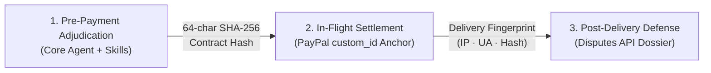

# ScopeGate Reviewer & Evaluation Showcase 🏆

> **Welcome, Judges & Reviewers!**  
> This directory houses the primary empirical evidence, architectural comparisons, policy verifications, real-world failure post-mortems, and evaluation suites supporting ScopeGate's hackathon submission.

---

## 🎯 Executive Pitch: What is ScopeGate?

**ScopeGate** is *the contract-boundary referee for agentic commerce*.



When autonomous AI agents buy and sell bespoke digital services (code, design, APIs):
1. **Before money moves**: A single embodied **Core Commerce Agent** mounts domain business skills and platform referee tools to adjudicate scope against the merchant's declarative baseline, defend against 9 prompt injection heuristics, and enforce deterministic ratchet pricing.
2. **When money moves**: The agreed scope freezes into an immutable 64-character SHA-256 contract hash written directly into PayPal's official ledger as `purchase_units[0].custom_id` across milestone stages (40/60).
3. **When disputes arise**: The gateway logs delivery access (IP, UA, timestamp, artifact hash) and generates a one-click admissible evidence package (Dossier) complying with PayPal's Seller Protection *Intangible Goods Additional Requirements*.

---

## 📂 Score-Boosting Deliverables Index

| Document | Primary Focus | Why It Boosts Scoring |
| :--- | :--- | :--- |
| **[`01. Architecture Comparison`](./architecture-comparison.md)** | Architecture Delta & Evolution | Proves why multi-agent mesh fails (10,000-token prompt explosion) and how our Single Agent + Skills architecture provides deterministic, lean execution. |
| **[`02. Evidence Table`](./evidence-table.md)** | Real-World Empirical Need | **11 first-hand cases** from Reddit & V2EX of freelancers losing PayPal disputes on intangible goods due to lack of physical tracking. |
| **[`03. Pain-Point & Policy Verification`](./painpoint-verification.md)** | Regulatory & Policy Soundness | Every load-bearing claim verified against primary sources: official PayPal Seller Protection text, Visa Core Rules, and PayPal OpenAPI specs. |
| **[`04. Gatekeeper Evaluation`](./gatekeeper-eval.md)** | Measured Rigor (56/56 Passing) | Empirical run-of-record on the live deployment: **56/56 assertions passed** across injection defense, ratchet pricing, and idempotent replays. |
| **[`05. Failed Experiments & Scope Reduction`](./failed-experiments.md)** | Engineering Honesty & Lessons | Real post-mortems from the build log: AG Grid UMD conflicts, model alias 13s latency traps, and the 10,000-token prompt diet. |
| **[`06. Related Work & Ecological Gap`](./related-work.md)** | Innovation & Differentiation | Detailed ecosystem positioning against x402, AP2, ACP, Stripe, and Upwork—proving what gap ScopeGate uniquely closes. |
| **[`07. Judge's 5-Minute Walkthrough`](./demo-walkthrough.md)** | Frictionless Verification | Quick walkthrough on the hosted sandbox deployment with a complete transparency table (real vs. simulated). |
| **[`08. Presenter Demo Script`](./demo-script.md)** | Presentation Narrative | "One deal, three beats, one fingerprint"—the exact sequence and narration used for high-impact live demos. |

---

## ⚡ 30-Second Reproduction

Verify the full evaluation suite locally with zero manual setup:

```bash
# 1. Start local server
npm start

# 2. Run the 56-assertion automated evaluation suite
npm run eval
```

All 56 assertions across prompt injection veto, dynamic surcharging ($500 base → $700 rush+extra revision), hash determinism, milestone locks, and dispute dossier export will execute and pass synchronously.
