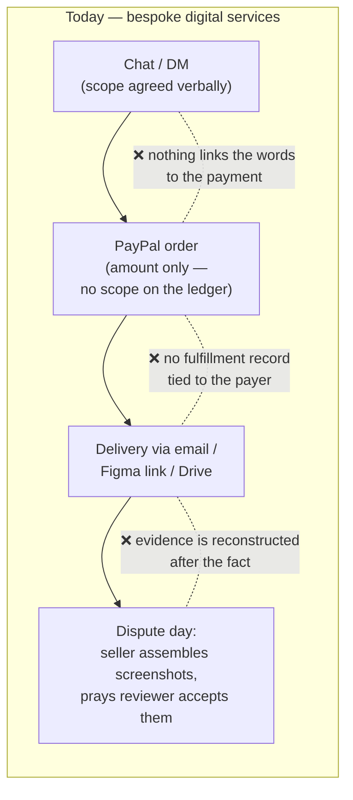
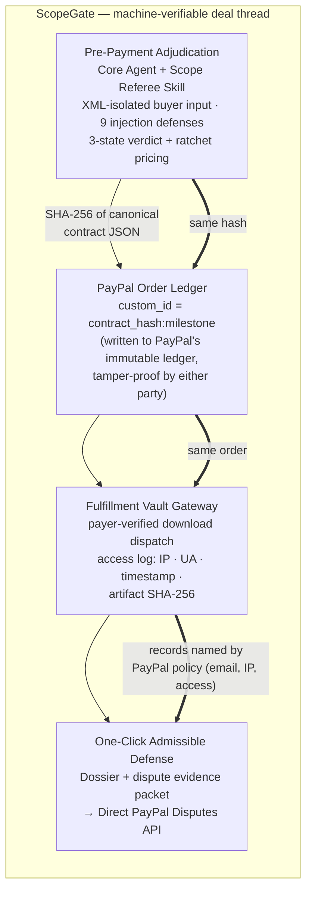
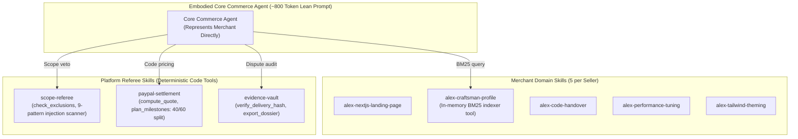

# Old World vs. ScopeGate: Where the Architecture Actually Changes

> Advisor-directed framing: show the delta, not the whole system.
> Read this side-by-side with [`showcase/painpoint-verification.md`](./painpoint-verification.md) — every annotated
> difference below is tied to a verified pain point.

---

## 1. The Old World: Four Disconnected Artifacts

The scope, the payment, the delivery, and the evidence live in four different systems
owned by four different parties. At dispute time, only the **payment** is provable —
and it proves the price, not the deal.

---

## 2. The ScopeGate World: One Hash, Four Anchors

---

## 3. The Agentic Architecture Evolution: Single Agent + Modular Skills

A common pitfall in AI commerce is building a **"Multi-Agent Mesh"** where 5 different agents (Concierge, Gatekeeper, Finance, Delivery, Legal) pass conversational messages back and forth. 

### Why Multi-Agent Mesh Failed:
- **10,000-Token Prompt Explosion**: Every user turn dumped all 5 agent profiles, complete legal text, and seller portfolios into context (over 23.6 KB JSON).
- **Latency & Hallucination**: Chained agent-to-agent chatter introduced latency spikes (10s+) and hallucinated financial figures.

### ScopeGate's Single Core Agent + Mounted Skills Architecture:
ScopeGate replaces virtual conversational roles with **one embodied Core Commerce Agent** backed by modular, on-demand **Skills**:

- **90% Prompt Reduction**: Base system prompt reduced to ~800 tokens.
- **In-Memory BM25 Indexer**: Domain knowledge and past case studies are recalled dynamically via pure Node.js BM25 indexing in under 5ms.
- **Zero LLM Math on Money**: The LLM is stripped of pricing arithmetic. The model identifies matched baseline surcharge rules; deterministic Node.js code tools compute quotes and 40/60 milestone splits.

---

## 4. The Delta Table (What is Actually New, per Pain Point)

| Pain point (verified in `painpoint-verification.md`) | Old-world failure | ScopeGate mechanism | Innovation type |
|---|---|---|---|
| **Scope creep & prompt injection** *(the 80% problem)* | Verbal scope, invisible until it's too late; agents can inject instructions into the deal text | **Pre-payment adjudication**: deterministic baseline comparison + LLM classification behind an XML firewall; price moves one way only (ratchet); verdict is ACCEPT / COUNTER / REJECT **before money moves** | Core product innovation — the admission referee itself |
| **Prompt token bloat & agent chatter** *(the latency problem)* | Dumping 5 agents into a 10,000-token prompt creates high latency and hallucinated negotiations | **Single Agent + Skills**: 1 embodied Core Agent, ~800 token prompt, in-memory BM25 indexer tool for knowledge, and deterministic code tools for pricing | Architecture innovation — modular agentic design |
| **Dispute black hole** *(the 20% problem)* | Evidence assembled by hand after the chargeback; wrong evidence categories; "as agreed" unprovable | **Contract hash anchoring**: the negotiated scope is hashed into a 64-char hex SHA-256 and written into `purchase_units[0].custom_id` on PayPal's own ledger at order creation; delivery events log exactly what PayPal's Intangible Goods Requirements mandate (recipient email, IP, access); one-click `provide-evidence` submission | The load-bearing crypto primitive — immutable ledger anchoring |
| **Escrow deadlock** *(deliberately 0% — borrowed, not built)* | Mutual distrust; self-built escrow = money-transmitter licensing death | **Borrowed rails**: PayPal milestone sequencing (deposit → stages → final; one anchored order per stage, next stage unlocks on logged acceptance) + hash-anchored contract. We build no custody, no ledger of our own | Strategic non-innovation — explicit regulatory boundary decision |

---

## 5. The One-Sentence Innovation Claim

> ScopeGate's innovation is not any single component but the **machine-verifiable thread**:
> one SHA-256 contract hash that is born in AI adjudication, anchored in PayPal's
> order ledger (`custom_id`), and reborn as admissible dispute evidence — turning "what did we agree?"
> from a he-said-she-said into an immutable cryptographic lookup.
